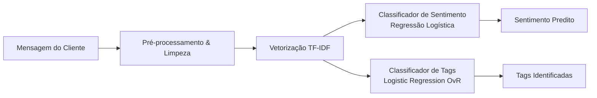

# 🧠 Detalhamento dos Métodos — Conversation Triage

## 📌 Visão Geral da Abordagem

O **Conversation Triage** é um sistema de Machine Learning e NLP projetado para automatizar a triagem e o roteamento de atendimentos de suporte ao cliente. O sistema resolve duas tarefas preditivas em paralelo:

1. **Análise de Sentimento (*Single-label*):** Classificação do tom do cliente em `positivo`, `neutro` ou `negativo`.
2. **Classificação de Tags / Categorias (*Multi-label*):** Identificação de tópicos e intenções da mensagem, tais como `login`, `reembolso`, `problema_técnico`, `cobrança`, etc.

---

## 📐 Fundamentos Teóricos e Modelagem Matemática

---

### 1. Teorema de Cover (*Cover's Theorem on Separability of Patterns*)

> **Fundamento central da eficácia do modelo baseline linear.**

* **Enunciado:** Um problema de classificação estatística que não é linearmente separável em um espaço de baixa dimensão torna-se linearmente separável, com alta probabilidade, quando projetado de forma não-linear em um espaço de dimensionalidade suficientemente alta.

$$\lim_{d \to \infty} P(\text{Separabilidade Linear em } \mathbb{R}^d) = 1$$

* **Aplicação no Pipeline:** O texto em linguagem natural apresenta relações semânticas complexas e não-lineares. Ao aplicar a vetorização por **TF-IDF** com unigramas e bigramas, cada documento é projetado em um espaço esparso de altíssima dimensão (milhares de dimensões correspondentes ao vocabulário). Segundo o Teorema de Cover, essa projeção viabiliza que um classificador linear simples (como a **Regressão Logística**) separe classes e categorias com alta acurácia e custo computacional mínimo.

---

### 2. Vetorização TF-IDF (*Term Frequency – Inverse Document Frequency*)

O **TF-IDF** transforma textos em vetores numéricos contínuos, equilibrando a importância local de cada palavra no documento com a sua relevância global no conjunto de dados (*corpus*):

* **TF (*Term Frequency*):** Mede a frequência relativa do termo $t$ dentro do documento específico $d$:
  $$\text{TF}(t, d) = \frac{f_{t, d}}{\sum_{t' \in d} f_{t', d}}$$

* **IDF (*Inverse Document Frequency*):** Mede a raridade ou especificidade da palavra no corpus com $N$ documentos:
  $$\text{IDF}(t) = \log\left(\frac{N}{|\{d \in D : t \in d\}|}\right) + 1$$

* **Peso TF-IDF Combinado:**
  $$\text{TF-IDF}(t, d) = \text{TF}(t, d) \times \text{IDF}(t)$$

* **Fundamento na Teoria da Informação de Shannon:**
  O cálculo do IDF baseia-se diretamente no conceito de **auto-informação (*surprisal*)** de Claude Shannon:
  
  $$I(x) = -\log P(x) = \log\left(\frac{1}{P(x)}\right)$$
  
  Termos frequentes em quase todos os documentos (*stopwords* como *"de"*, *"a"*, *"o"*) possuem probabilidade $P(t) \approx 1$ e carregam informação discriminatória próxima de zero. Termos raros e específicos (*"estorno"*, *"bloqueio"*, *"fatura"*) carregam alta entropia/informação útil para a tarefa de triagem.

---

### 3. Regressão Logística (*Logistic Regression*)

Apesar do nome "regressão", trata-se de um algoritmo supervisionado de classificação probabilística linear.

#### 3.1 Combinação Linear das Features
Para um texto representado pelo vetor de features $\mathbf{x} = [x_1, x_2, \dots, x_n]^T$ (pesos TF-IDF das palavras no documento), o modelo calcula uma combinação linear ponderada pelos pesos aprendidos $\mathbf{w} = [w_1, w_2, \dots, w_n]^T$ somados ao viés (*intercept*) $b$:

$$z = \mathbf{w}^T \mathbf{x} + b = \sum_{i=1}^{n} w_i x_i + b$$

Onde:
* $x_i$: Peso TF-IDF do termo $i$ no documento;
* $w_i$: Coeficiente aprendido para a palavra $i$;
* $b$: Viés (*bias* / intercepto).

#### 3.2 Função de Ativação Sigmoide
O valor escalar $z \in (-\infty, +\infty)$ é mapeado no intervalo probabilístico $[0, 1]$ através da função sigmoide $\sigma(z)$:

$$p = \sigma(z) = \frac{1}{1 + e^{-z}}$$

* $p = P(Y = 1 \mid \mathbf{x})$: Probabilidade da instância pertencer à classe positiva.
* **Regra de Decisão:**
  $$\hat{y} = \begin{cases} 1, & \text{se } p \ge \tau \text{ (limiar padrão: } 0{,}5) \\ 0, & \text{se } p < \tau \end{cases}$$

#### 3.3 Extensão para Múltiplas Classes e Múltiplos Rótulos
* **Classificação Multiclasse (Sentimento):** Utiliza a formulação **Multinomial (Softmax)** ou **One-vs-Rest (OvR)**:
  $$P(Y = k \mid \mathbf{x}) = \frac{e^{\mathbf{w}_k^T \mathbf{x} + b_k}}{\sum_{j=1}^{K} e^{\mathbf{w}_j^T \mathbf{x} + b_j}}$$
* **Classificação Multirrótulo (Tags de Atendimento):** Utiliza **Binary Relevance** (um classificador sigmoide independente por tag), permitindo que uma mensagem receba zero, uma ou múltiplas tags simultaneamente.

#### 3.4 Função de Custo e Otimização
O treinamento minimiza a perda de entropia cruzada binária (*Binary Cross-Entropy / Log-Loss*) com termo de regularização $L_2$ (Ridge):

$$\mathcal{L}(\mathbf{w}, b) = -\frac{1}{N} \sum_{i=1}^{N} \left[ y_i \log(p_i) + (1 - y_i) \log(1 - p_i) \right] + \frac{\lambda}{2} \|\mathbf{w}\|_2^2$$

#### 3.5 Interpretabilidade Direta
A Regressão Logística oferece alta transparência: os coeficientes $w_i$ indicam diretamente o impacto de cada palavra na decisão:
* **Pesos positivos altos ($w_i > 0$):** Empurram a predição em direção à classe (ex.: *"excelente"*, *"rápido"* para tom positivo; *"estorno"*, *"pix"* para tag financeira).
* **Pesos negativos ($w_i < 0$):** Desfavorecem a associação com aquela categoria.

---

### 4. Teorema de Bayes e Calibração Probabilística

* **Equação Fundamental:**
  $$P(Y = c \mid \mathbf{x}) = \frac{P(\mathbf{x} \mid Y = c) \cdot P(Y = c)}{P(\mathbf{x})}$$

* **Aplicação no Pipeline:** A Regressão Logística modela diretamente a probabilidade a posteriori $P(Y = c \mid \mathbf{x})$. Essa modelagem probabilística permite:
  1. **Ajuste de Limiares (*Threshold Tuning*):** Flexibilidade para priorizar precisão ou recall conforme a criticidade de cada tag.
  2. **Score de Confiança:** Mensagens com probabilidade próxima ao limiar ($p \approx 0{,}5$) podem ser sinalizadas para revisão humana (revisão de incerteza).

---

### 5. Estimativa de Máxima Verossimilhança (*MLE*) e Otimização Convexa

* **Convexidade Estrita:** A função de perda da Regressão Logística com regularização $L_2$ é estritamente convexa.
* **Garantia de Mínimo Global:** Devido à convexidade, qualquer algoritmo de otimização baseado em gradientes (como o `L-BFGS`) converge comprovadamente para o **mínimo global**, eliminando o risco de ficar preso em mínimos locais indesejados.
* **Propriedades Assintóticas:** Sob a teoria de MLE (*Maximum Likelihood Estimation*), as estimativas dos pesos convergem assintoticamente para os valores ótimos com eficiência estatística.

---

## 📊 Matriz Comparativa de Modelos

| Dimensão | Baseline (TF-IDF + Regressão Logística) | Modelo Neural (DistilBERT / RoBERTa) |
| :--- | :--- | :--- |
| **Tempo de Treinamento** | Segundos (CPU) | Minutos a horas (GPU necessária) |
| **Latência de Inferência** | $< 5\text{ ms}$ por requisição | $20\text{--}80\text{ ms}$ (CPU/GPU) |
| **Consumo de Memória** | Leve ($< 200\text{ MB}$) | Moderado/Alto ($> 1\text{ GB}$) |
| **Interpretabilidade** | Direta via pesos $\mathbf{w}$ | Indireta (Attention weights, SHAP, LIME) |
| **Sensibilidade à Ordem** | Bag-of-Words (atenua ordem sintática) | Plena atenção bidirecional ao contexto |
| **Casos Ideais** | Deploy de alta vazão, prototipação rápida | Sutilezas contextuais, ironia, frases longas |

---

## 📖 Glossário

* **NLP (*Natural Language Processing*):** Processamento de Linguagem Natural.
* **TF-IDF (*Term Frequency – Inverse Document Frequency*):** Ponderação estatística de termos em documentos e coleções.
* **MLE (*Maximum Likelihood Estimation*):** Estimativa de Máxima Verossimilhança.
* **Log-Loss / Binary Cross-Entropy:** Função de perda padrão para modelos probabilísticos de classificação.
* **One-vs-Rest (OvR):** Estratégia de decomposição de problemas multiclasse em múltiplos classificadores binários.
* **DistilBERT:** Versão destilada e compacta da arquitetura BERT, com $40\%$ menos parâmetros e retenção de $97\%$ da capacidade semântica.
